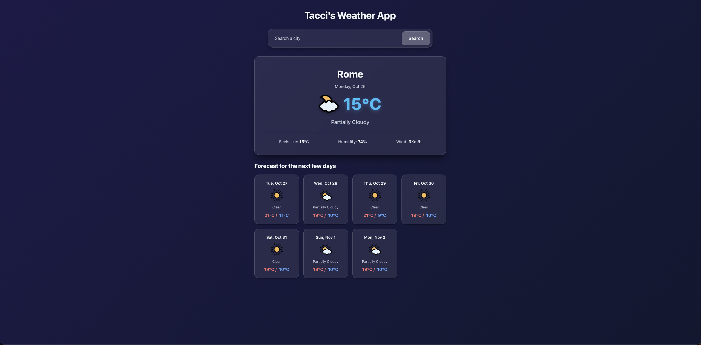

# Weather App

> A fully functional weather application built with HTML, CSS, and JavaScript, featuring real-time data integration, dynamic backgrounds, and a modern glassmorphism aesthetic.

---

## Live Demo

**Live Demo:** [taaccii.github.io/weather-app](https://taaccii.github.io/weather-app/)

---

## Features

- **Modular architecture** — code split across dedicated modules for API requests, data processing, DOM rendering, and main control flow, following best practices
- **Real-time weather data** — integrates with the Visual Crossing API using metric units to fetch accurate current conditions and multi-day forecasts
- **Dynamic background gradients** — background styling shifts dynamically based on current weather conditions such as clear skies, rain, clouds, or snow
- **Interactive search** — search bar with instant feedback, loading states, and robust error handling for invalid locations
- **Detailed weather metrics** — displays temperature, feels-like temperature, humidity levels, and wind speed alongside clean condition descriptions
- **Visual card forecast** — multi-day forecast displayed in responsive grid cards complete with min and max temperatures and custom weather icons
- **Glassmorphism design** — sleek frosted glass cards, subtle borders, deep slate color palette, and smooth transitions

---

## Tech Stack

| Component | Technology |
|-----------|------------|
| **Markup** | HTML5 |
| **Style** | CSS3 |
| **Logic** | JavaScript (ES6+) |
| **Bundler** | Webpack |
| **API** | Visual Crossing Weather API |
| **Icons** | Statically Weather Icons CDN |

---

## Architecture

| Module | Responsibility |
|--------|----------------|
| `api.js` | Handles asynchronous network requests to the Visual Crossing weather service |
| `weatherData.js` | Filters and processes raw API responses into clean application objects |
| `domController.js` | Manages all DOM manipulations, rendering updates, loading spinners, and error states |
| `index.js` | Coordinates the main execution flow, event listeners, and search handling |

---

## What I Learned

- Asynchronous JavaScript handling with async and await and robust try catch blocks for network errors
- Consuming external REST APIs and structuring API parameters for precise data delivery
- Structuring a modern web project using Webpack for bundling assets and styles
- Separating concerns cleanly by isolating API logic, data formatting, and DOM rendering into individual modules
- Implementing dynamic CSS state changes using data attributes on the body element
- Designing modern user interfaces with CSS backdrop filters, flexbox, and CSS grid layouts

---

## Notes

This project was built as part of the JavaScript curriculum on The Odin Project. The main challenge was structuring asynchronous data flow cleanly and ensuring the user interface remained responsive and resilient during network operations. Implementing the modular pattern helped keep the codebase organized and easy to maintain.

---

## License

This project is licensed under the **MIT License** — see [`LICENSE`](./LICENSE) for details.

---

## Author

**Taaccii**

- Email: [taccidev@gmail.com](mailto:taccidev@gmail.com)
- GitHub: [@Taaccii](https://github.com/Taaccii)
- LinkedIn: [alessandro-barletta-dev](https://linkedin.com/in/alessandro-barletta-dev)

---

> Project built as part of [The Odin Project](https://www.theodinproject.com/lessons/node-path-javascript-weather-app) JavaScript curriculum.